# BrandForge Backend

> REST API powering **BrandForge** — a platform that connects **brands** and **content creators** through structured campaigns, contests, and submissions.


This repository contains the **backend API only**. The frontend is a separate application served from `http://localhost:5173` in development and `https://brand-forge-frontend.vercel.app` in production.

---

## Table of Contents

- [Overview](#overview)
- [Feature Highlights](#feature-highlights)
- [Tech Stack](#tech-stack)
- [System Architecture](#system-architecture)
- [Request Lifecycle](#request-lifecycle)
- [Project Structure](#project-structure)
- [Domain Model](#domain-model)
- [Roles & Permissions](#roles--permissions)
- [Authentication & Authorization](#authentication--authorization)
- [API Reference](#api-reference)
  - [Auth API](#auth-api)
  - [Campaign API](#campaign-api)
  - [Submission API](#submission-api)
  - [Analytics API](#analytics-api)
- [Campaign Lifecycle](#campaign-lifecycle)
- [Submission Lifecycle](#submission-lifecycle)
- [End-to-End Flow](#end-to-end-flow)
- [Analytics & Distribution](#analytics--distribution)
- [Validation Matrix](#validation-matrix)
- [Error Handling](#error-handling)
- [Security](#security)
- [Getting Started](#getting-started)
- [Environment Variables](#environment-variables)
- [Deployment](#deployment)
- [API Conventions](#api-conventions)
- [Known Limitations](#known-limitations)
- [Roadmap](#roadmap)
- [Contributing](#contributing)
- [License](#license)

---

## Overview

BrandForge solves the problem of fragmented influencer marketing by providing a **centralized platform** where:

- **Brands** create campaigns, set rewards and deadlines, review creator entries, and pick winners.
- **Creators** discover approved campaigns, submit content links before the deadline, and track results.
- **Admins** approve or reject campaigns, monitor platform-wide activity, and moderate the ecosystem.

The backend is a layered Express application: **routes → middleware → controllers → Mongoose models → MongoDB**. Authentication uses **JWT stored in an `httpOnly` cookie**, and authorization uses **role-based access control (RBAC)** with per-resource ownership checks.

### At a Glance

| Property | Value |
| --- | --- |
| API style | REST / JSON |
| Entry point | `src/server.js` |
| Default port | `5000` |
| Authentication | JWT (1-day expiry) in `httpOnly` cookie |
| Authorization | Role-based (`brand`, `creator`, `admin`) + ownership checks |
| Database | MongoDB via Mongoose |
| Password storage | bcrypt hash (10 salt rounds) |
| Rate limiting | In-memory, per-IP |
| CORS | Allowlist: localhost:5173 + deployed Vercel frontend |
| Health check | `GET /` |

---

## Feature Highlights

### Accounts & Authentication
- Registration with server-side field validation and duplicate-email protection
- Login issuing a signed JWT in a secure cookie
- Authenticated profile lookup, name updates, and password changes
- Stricter rate limiting on authentication endpoints

### Campaigns
- Brand campaign creation with future-deadline enforcement
- Admin approval and rejection workflow
- Pagination, search (title/description), status filtering, and safe sorting
- Ownership-aware visibility (brands see their own campaigns; creators see approved campaigns)
- Campaign completion and guarded deletion (blocked while submissions exist)

### Submissions
- Creator submissions restricted to approved, open, third-party campaigns
- Database-level uniqueness: one submission per creator per campaign
- Brand/admin review with optional feedback notes
- Winner selection with ownership checks
- Creator dashboards: own submissions and won contests

### Analytics
- Platform-wide metrics for admins (users, campaigns, submissions, win rate)
- Brand performance metrics (active/pending campaigns, submissions received, winners)
- Creator participation metrics (submissions, wins, pending entries, win rate)

### Platform Hardening
- Security headers (nosniff, frame denial, HSTS, referrer policy)
- IP-based rate limiting with `Retry-After` responses
- Centralized error handler for Mongoose, JWT, and JSON parse errors
- ReDoS-safe search via regex escaping
- ObjectId format validation middleware
- Password stripped from every serialized user document

---

## Tech Stack

| Layer | Technology | Version | Purpose |
| --- | --- | --- | --- |
| Runtime | Node.js (CommonJS) | — | Server runtime |
| Web framework | Express | `^5.2.1` | Routing, middleware, request handling |
| ODM | Mongoose | `^9.0.2` | Schemas, validation, queries, indexes |
| Database | MongoDB (Atlas or local) | — | Persistent storage |
| Auth tokens | jsonwebtoken | `^9.0.3` | Signing and verifying JWTs |
| Password hashing | bcryptjs | `^3.0.3` | Salted password hashes |
| Cookies | cookie-parser | `^1.4.7` | Reading the auth cookie |
| CORS | cors | `^2.8.5` | Credentialed cross-origin access |
| Env config | dotenv | `^17.2.3` | Loading `.env` into `process.env` |
| Dev tooling | nodemon | `^3.1.11` | Auto-restart during development |
| Deployment | Render | — | Hosts the API |

> There is currently no test framework configured and no `start` script — the dev server runs with `npm run dev`, and production starts with `node src/server.js`.

---

## System Architecture

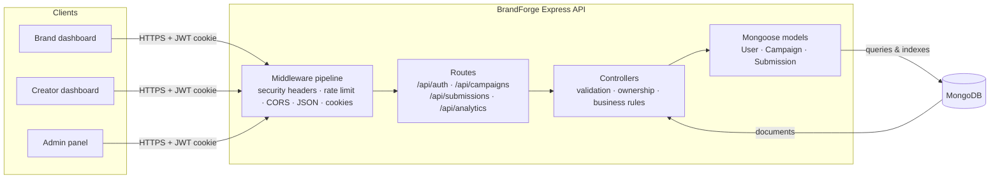

**Layer responsibilities**

| Layer | Location | Responsibility |
| --- | --- | --- |
| Middleware | `src/middleware` | Authentication, role checks, ObjectId validation, security headers, rate limiting, error handling |
| Routes | `src/routes` | URL-to-controller mapping and per-route guard composition |
| Controllers | `src/controllers` | Input validation, business rules, ownership checks, HTTP responses |
| Models | `src/models` | Schema constraints, indexes, serialization rules |
| Utilities | `src/utils` | Pagination parsing, metadata building, regex escaping |
| Config | `src/config` | MongoDB connection lifecycle |

---

## Request Lifecycle

Every request flows through the same middleware chain before reaching a controller. Errors that escape a controller are normalized by the central error handler.

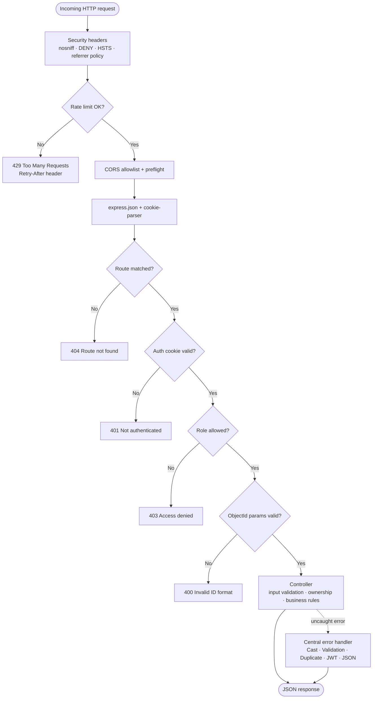

---

## Project Structure

```text
backend/
├── src/
│   ├── server.js                         # App bootstrap: middleware, routes, 404, error handler
│   ├── config/
│   │   └── db.js                         # Mongoose connection (exits process on failure)
│   ├── middleware/
│   │   ├── auth.middleware.js            # Verifies JWT from the "token" cookie
│   │   ├── role.middleware.js            # Role allowlist factory (RBAC)
│   │   ├── validateObjectId.middleware.js# Validates MongoDB ObjectId params/body fields
│   │   ├── rateLimiter.middleware.js     # In-memory per-IP limiter + auth/api presets
│   │   ├── security.middleware.js        # Security response headers
│   │   └── error.middleware.js           # Centralized error normalization
│   ├── models/
│   │   ├── User.js                       # Account + role enum + password stripping
│   │   ├── Campaign.js                   # Campaign lifecycle + compound indexes
│   │   └── Submission.js                 # Entry lifecycle + unique (campaign, creator)
│   ├── routes/
│   │   ├── auth.routes.js
│   │   ├── campaign.routes.js
│   │   ├── submission.routes.js
│   │   └── analytics.routes.js
│   ├── controllers/
│   │   ├── auth.controller.js
│   │   ├── campaign.controller.js
│   │   ├── submission.controller.js
│   │   └── analytics.controller.js
│   └── utils/
│       └── queryHelper.js                # Pagination, metadata, regex escaping
├── .env                                  # Local secrets (git-ignored)
├── package.json
└── README.md
```

---

## Domain Model

Three collections with referential relationships. MongoDB enforces uniqueness and indexes; Mongoose enforces schema-level constraints.

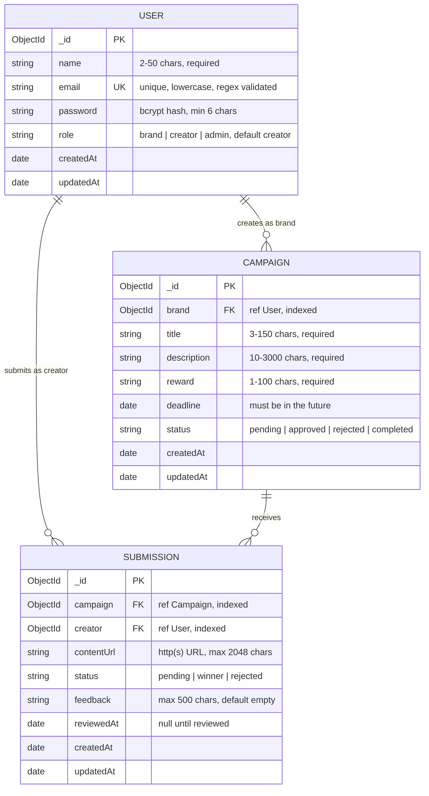

### Indexes

| Collection | Index | Purpose |
| --- | --- | --- |
| `User` | `email` (unique) | Login lookup + duplicate prevention |
| `Campaign` | `brand` | Brand-owned campaign queries |
| `Campaign` | `status`, `createdAt` (desc) | Filtered, newest-first listing |
| `Campaign` | `brand`, `createdAt` (desc) | Brand dashboard listing |
| `Campaign` | `status`, `deadline` | Active/expiring campaign queries |
| `Submission` | `campaign` + `creator` (**unique**) | One entry per creator per campaign |
| `Submission` | `creator`, `status` | Creator win/pending counts |
| `Submission` | `creator`, `createdAt` (desc) | Creator submission history |
| `Submission` | `campaign`, `createdAt` (desc) | Campaign submission review list |

---

## Roles & Permissions

| Capability | Creator | Brand | Admin |
| --- | :---: | :---: | :---: |
| Register / login / logout | Yes | Yes | Yes |
| View profile / update name / change password | Yes | Yes | Yes |
| Browse campaigns | Yes (approved only) | Yes (approved + own) | Yes (all) |
| Create campaign | No | Yes | No |
| Edit campaign | No | Own campaigns | Any campaign |
| Delete campaign (no submissions) | No | Own campaigns | Any campaign |
| Approve / reject campaign | No | No | Yes |
| Mark campaign complete | No | Own campaigns | Any campaign |
| Submit entry to campaign | Yes (not own, approved, open) | No | No |
| View submissions for a campaign | No | Own campaigns | Any campaign |
| Select winner / review submission | No | Own campaigns | Any campaign |
| View own submissions / wins | Yes | No | No |
| Analytics | Creator stats | Brand stats | Platform stats |

> Ownership checks happen **inside controllers** after the role gate, so a valid brand cannot act on another brand's campaign.

---

## Authentication & Authorization

### Flow

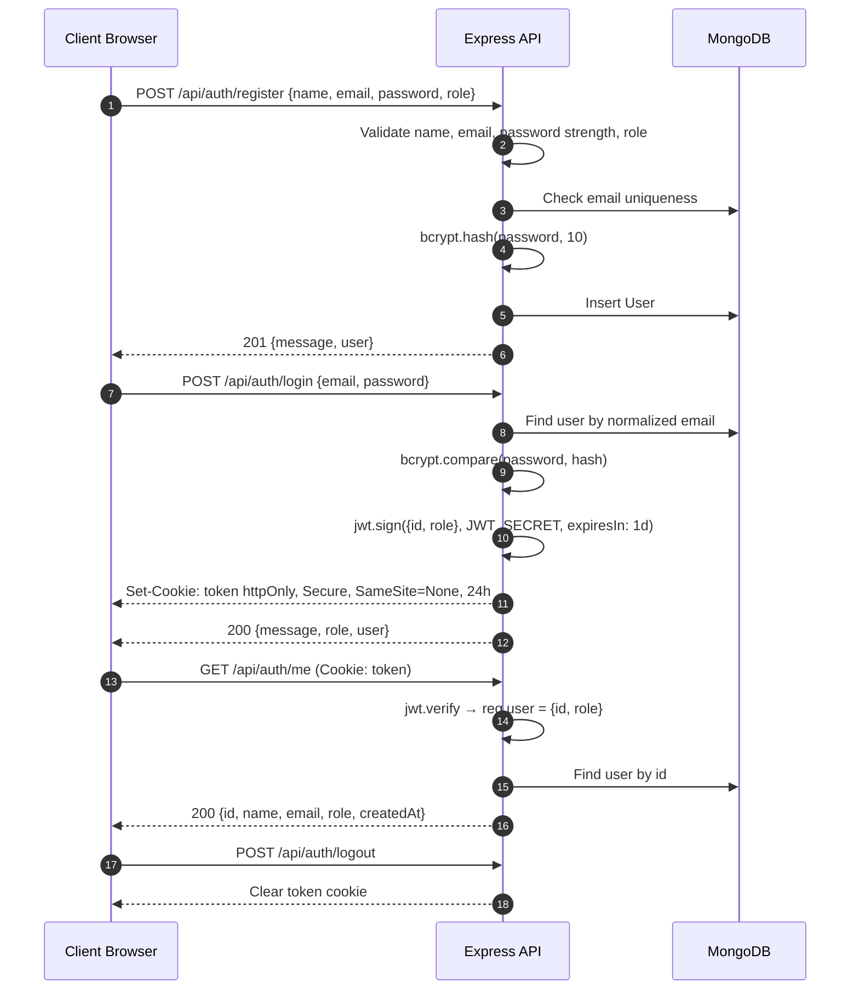

### Token & Cookie Details

| Property | Value |
| --- | --- |
| Cookie name | `token` |
| Payload | `{ id, role }` |
| Expiry | 1 day (`expiresIn: "1d"`) |
| Flags | `httpOnly: true`, `secure: true`, `sameSite: "none"` |
| Max age | 24 hours |
| Transport | Cookie only — no `Authorization: Bearer` support |

> Because the cookie is `SameSite=None; Secure`, the frontend must be served over **HTTPS** in production. `localhost` is treated as a secure context by browsers, so local development works.

### Password Rules

- Minimum 6 characters
- Must contain at least one letter and one number
- Hashed with bcrypt (10 rounds) before storage
- New password must differ from the current password on change
- Password is removed from all JSON/object serialization

### Authorization Layers

1. **Authentication** — `auth.middleware.js` verifies the JWT cookie.
2. **Role gate** — `role.middleware.js` checks `req.user.role` against the allowed roles.
3. **ObjectId guard** — `validateObjectId.middleware.js` rejects malformed IDs before any DB call.
4. **Ownership check** — controllers compare the resource owner with `req.user.id` (admins bypass).

---

## API Reference

**Base URL:** `http://localhost:5000`

All endpoints return JSON. Protected routes require the `token` cookie set by login.

### Endpoint Summary

| # | Method | Endpoint | Access | Description |
| --- | --- | --- | --- | --- |
| 1 | `POST` | `/api/auth/register` | Public | Create an account |
| 2 | `POST` | `/api/auth/login` | Public | Authenticate and receive a cookie |
| 3 | `POST` | `/api/auth/logout` | Public | Clear the auth cookie |
| 4 | `GET` | `/api/auth/me` | Authenticated | Get the current profile |
| 5 | `PUT` | `/api/auth/profile` | Authenticated | Update display name |
| 6 | `PUT` | `/api/auth/password` | Authenticated | Change password |
| 7 | `POST` | `/api/campaigns` | Brand | Create a campaign |
| 8 | `GET` | `/api/campaigns` | Authenticated | List campaigns (paginated/filterable) |
| 9 | `GET` | `/api/campaigns/pending` | Admin | List campaigns awaiting review |
| 10 | `GET` | `/api/campaigns/:id` | Authenticated | Get a campaign by ID |
| 11 | `PUT` | `/api/campaigns/:id` | Brand, Admin | Update a campaign |
| 12 | `PUT` | `/api/campaigns/:id/complete` | Brand, Admin | Mark campaign completed |
| 13 | `PUT` | `/api/campaigns/:id/approve` | Admin | Approve a campaign |
| 14 | `PUT` | `/api/campaigns/:id/reject` | Admin | Reject a campaign |
| 15 | `DELETE` | `/api/campaigns/:id` | Brand, Admin | Delete a campaign with no submissions |
| 16 | `POST` | `/api/submissions` | Creator | Submit an entry |
| 17 | `PUT` | `/api/submissions/:id/winner` | Brand, Admin | Mark a submission as winner |
| 18 | `PUT` | `/api/submissions/:id/review` | Brand, Admin | Update status and/or feedback |
| 19 | `GET` | `/api/submissions/campaign/:campaignId` | Brand, Admin | List submissions for a campaign |
| 20 | `GET` | `/api/submissions/my-wins` | Creator | List the creator's winning entries |
| 21 | `GET` | `/api/submissions/mine` | Creator | List the creator's submissions |
| 22 | `GET` | `/api/analytics/admin` | Admin | Platform-wide statistics |
| 23 | `GET` | `/api/analytics/brand` | Brand | Brand performance statistics |
| 24 | `GET` | `/api/analytics/creator` | Creator | Creator participation statistics |

---

### Auth API

#### `POST /api/auth/register`

**Rate limit:** 15 requests / 15 minutes / IP

```json
{
  "name": "Ava Sharma",
  "email": "ava@example.com",
  "password": "brandpass1",
  "role": "brand"
}
```

| Field | Required | Rules |
| --- | --- | --- |
| `name` | Yes | 2–50 characters after trimming |
| `email` | Yes | Valid email, lowercased and trimmed; unique |
| `password` | Yes | Min 6 chars, at least one letter and one number |
| `role` | No | `brand`, `creator`, or `admin`; defaults to `creator` |

**Success — `201 Created`**

```json
{
  "message": "Registered successfully",
  "user": {
    "_id": "66f1c2a1e4b0a9d8f7c12345",
    "name": "Ava Sharma",
    "email": "ava@example.com",
    "role": "brand",
    "createdAt": "2026-10-20T09:00:00.000Z",
    "updatedAt": "2026-10-20T09:00:00.000Z"
  }
}
```

> `password` and `__v` are stripped by the schema's `toJSON` transform. Credentials are not issued at registration — log in afterwards.

---

#### `POST /api/auth/login`

**Rate limit:** 15 requests / 15 minutes / IP

```json
{
  "email": "ava@example.com",
  "password": "brandpass1"
}
```

**Success — `200 OK`** — sets `token` cookie and returns:

```json
{
  "message": "Login successful",
  "role": "brand",
  "user": {
    "id": "66f1c2a1e4b0a9d8f7c12345",
    "name": "Ava Sharma",
    "email": "ava@example.com",
    "role": "brand"
  }
}
```

**Failure — `400 Bad Request`**

```json
{ "message": "Invalid credentials" }
```

The same message is returned for an unknown email and a wrong password to avoid account enumeration.

---

#### `POST /api/auth/logout`

Clears the `token` cookie. No authentication required.

```json
{ "message": "Logged out successfully" }
```

---

#### `GET /api/auth/me`

Returns the authenticated user's profile.

```json
{
  "id": "66f1c2a1e4b0a9d8f7c12345",
  "name": "Ava Sharma",
  "email": "ava@example.com",
  "role": "brand",
  "createdAt": "2026-10-20T09:00:00.000Z"
}
```

---

#### `PUT /api/auth/profile`

```json
{ "name": "Ava S. Sharma" }
```

Returns `200` with the updated user. Name must be 2–50 characters after trimming.

---

#### `PUT /api/auth/password`

```json
{
  "currentPassword": "brandpass1",
  "newPassword": "newbrandpass2"
}
```

| Check | Failure response |
| --- | --- |
| Both fields present | `400` — "Current and new passwords are required" |
| New password strength | `400` — must be 6+ chars with a letter and a number |
| New differs from current | `400` — "New password must be different from current password" |
| Current password correct | `400` — "Current password is incorrect" |

**Success — `200 OK`**

```json
{ "message": "Password updated successfully" }
```

> Existing JWTs remain valid until their 24-hour expiry — see [Known Limitations](#known-limitations).

---

### Campaign API

#### `POST /api/campaigns`

**Access:** Brand only

```json
{
  "title": "EcoSip Spring Launch",
  "description": "Create a short-form video featuring our new reusable bottle.",
  "reward": "$500 + product bundle",
  "deadline": "2026-12-01T18:00:00.000Z"
}
```

| Field | Required | Rules |
| --- | --- | --- |
| `title` | Yes | 3–150 characters |
| `description` | Yes | 10–3000 characters |
| `reward` | Yes | 1–100 characters |
| `deadline` | Yes | Valid date, **at least 1 hour** in the future |

- New campaigns always start as `pending` (client-supplied status is ignored).
- `brand` is taken from the authenticated user, never from the request body.

**Success — `201 Created`** returns the campaign document.

---

#### `GET /api/campaigns`

**Access:** Authenticated (all roles)

**Visibility rules**

| Role | Sees |
| --- | --- |
| `admin` | All campaigns |
| `brand` | Approved campaigns **or** campaigns they own |
| `creator` | Approved campaigns only |

**Query parameters**

| Parameter | Default | Description |
| --- | --- | --- |
| `page` | `1` | Page number (≥ 1) |
| `limit` | `10` | Page size (1–50; values above 50 are clamped) |
| `search` | — | Case-insensitive substring match on `title` or `description` (regex-escaped) |
| `status` | — | Filter by `pending`, `approved`, `rejected`, `completed` |
| `sortBy` | `createdAt` | One of `createdAt`, `deadline`, `title` |
| `sortOrder` | `desc` | `asc` or `desc` |

**Example**

```http
GET /api/campaigns?page=1&limit=10&search=bottle&status=approved&sortBy=deadline&sortOrder=asc
```

**Response — structured (when `page`, `limit`, `search`, or `status` is supplied)**

```json
{
  "data": [
    {
      "_id": "66f1c2a1e4b0a9d8f7c54321",
      "brand": { "_id": "66f1c2a1e4b0a9d8f7c12345", "name": "Ava Sharma", "email": "ava@example.com" },
      "title": "EcoSip Spring Launch",
      "description": "Create a short-form video featuring our new reusable bottle.",
      "reward": "$500 + product bundle",
      "deadline": "2026-12-01T18:00:00.000Z",
      "status": "approved",
      "createdAt": "2026-10-20T09:05:00.000Z",
      "updatedAt": "2026-10-20T09:10:00.000Z"
    }
  ],
  "pagination": {
    "totalItems": 1,
    "currentPage": 1,
    "totalPages": 1,
    "limit": 10,
    "hasNextPage": false,
    "hasPrevPage": false
  }
}
```

**Response — legacy array (when no pagination/search/status params are supplied)**

```json
[ { "_id": "...", "title": "...", "status": "approved" } ]
```

> This dual shape is intentional backwards compatibility with the existing frontend. See [Known Limitations](#known-limitations).

---

#### `GET /api/campaigns/pending`

**Access:** Admin only

Returns all `pending` campaigns, newest first, with brand `name` and `email` populated.

```json
[
  {
    "_id": "66f1c2a1e4b0a9d8f7c54321",
    "title": "EcoSip Spring Launch",
    "status": "pending",
    "brand": { "_id": "66f1c2a1e4b0a9d8f7c12345", "name": "Ava Sharma", "email": "ava@example.com" }
  }
]
```

---

#### `GET /api/campaigns/:id`

**Access:** Authenticated

| Viewer | Access |
| --- | --- |
| Admin | Any campaign |
| Brand (owner) | Any status |
| Brand (non-owner) | Approved only |
| Creator | Approved only |

Non-approved campaigns viewed by non-owners return `403 Access denied to pending campaign`.

---

#### `PUT /api/campaigns/:id`

**Access:** Brand (owner) or Admin

All fields optional; only supplied fields are updated.

| Field | Rules |
| --- | --- |
| `title` | 3–150 characters |
| `description` | 10–3000 characters |
| `reward` | 1–100 characters |
| `deadline` | Valid future date |

**Guards**

- `completed` and `rejected` campaigns cannot be edited (`400`).
- Editing an approved campaign does **not** reset it to `pending`.

**Success — `200 OK`**

```json
{ "message": "Campaign updated successfully", "campaign": { "...": "..." } }
```

---

#### `PUT /api/campaigns/:id/complete`

**Access:** Brand (owner) or Admin

Sets `status` to `completed`. Returns `400` if already completed.

---

#### `PUT /api/campaigns/:id/approve`

**Access:** Admin only

**Guards**

- Already approved → `400`
- Deadline has passed → `400` ("Cannot approve a campaign whose deadline has already passed")

On success the campaign becomes visible to creators.

---

#### `PUT /api/campaigns/:id/reject`

**Access:** Admin only

Sets `status` to `rejected`. Returns `400` if already rejected.

---

#### `DELETE /api/campaigns/:id`

**Access:** Brand (owner) or Admin

**Guard:** refuses deletion when submissions exist:

```json
{
  "message": "Cannot delete campaign with existing submissions. Consider marking it completed instead."
}
```

---

### Submission API

#### `POST /api/submissions`

**Access:** Creator only

```json
{
  "campaignId": "66f1c2a1e4b0a9d8f7c54321",
  "contentUrl": "https://youtube.com/shorts/example-entry"
}
```

**Eligibility checks, in order**

1. `campaignId` and `contentUrl` are present → otherwise `400`
2. Campaign exists → otherwise `404`
3. Campaign is `approved` → otherwise `400`
4. Deadline has not passed → otherwise `400`
5. Requester is not the campaign's brand → otherwise `400`
6. No existing submission by this creator for this campaign → otherwise `400`
7. URL matches `^https?://...` and is at most 2048 characters

The unique compound index `(campaign, creator)` is the final arbiter — concurrent duplicate requests surface as a `400` via duplicate-key handling.

**Success — `201 Created`** returns the submission with `status: "pending"`.

---

#### `PUT /api/submissions/:id/winner`

**Access:** Brand (campaign owner) or Admin

- Already a winner → `400`
- Sets `status: "winner"` and `reviewedAt: now`

**Success — `200 OK`**

```json
{ "message": "Winner selected successfully", "submission": { "...": "..." } }
```

> Multiple winners per campaign are allowed by design; there is no unique-winner constraint.

---

#### `PUT /api/submissions/:id/review`

**Access:** Brand (campaign owner) or Admin

```json
{
  "status": "rejected",
  "feedback": "Entry does not follow the brief."
}
```

| Field | Rules |
| --- | --- |
| `status` | Optional; one of `pending`, `winner`, `rejected` |
| `feedback` | Optional; trimmed, max 500 characters |

Sets `reviewedAt` on every review. Either field may be sent alone.

**Success — `200 OK`**

```json
{ "message": "Submission review updated successfully", "submission": { "...": "..." } }
```

---

#### `GET /api/submissions/campaign/:campaignId`

**Access:** Brand (campaign owner) or Admin

Returns submissions for the campaign, newest first, with creator `name` and `email` populated. Non-owners receive `403`.

---

#### `GET /api/submissions/my-wins`

**Access:** Creator only

Returns the creator's `winner` submissions with campaign `title`, `reward`, `deadline`, and `status` populated, newest first.

---

#### `GET /api/submissions/mine`

**Access:** Creator only

Returns all of the creator's submissions (any status) with campaign summary fields, newest first.

---

### Analytics API

#### `GET /api/analytics/admin`

**Access:** Admin only

```json
{
  "users": {
    "total": 42,
    "breakdown": { "brand": 12, "creator": 27, "admin": 3 }
  },
  "campaigns": {
    "total": 18,
    "breakdown": { "pending": 4, "approved": 9, "rejected": 2, "completed": 3 }
  },
  "submissions": {
    "total": 96,
    "winners": 7,
    "winRatePercent": "7.29"
  }
}
```

---

#### `GET /api/analytics/brand`

**Access:** Brand only — scoped to the caller's campaigns

```json
{
  "totalCampaigns": 6,
  "activeCampaigns": 3,
  "pendingCampaigns": 1,
  "totalSubmissionsReceived": 48,
  "winnersSelected": 4,
  "averageSubmissionsPerCampaign": "8.0"
}
```

| Metric | Definition |
| --- | --- |
| `activeCampaigns` | `approved` **and** deadline in the future |
| `pendingCampaigns` | `pending` |
| `averageSubmissionsPerCampaign` | Submissions received ÷ total campaigns (1 decimal) |

---

#### `GET /api/analytics/creator`

**Access:** Creator only

```json
{
  "totalSubmissions": 12,
  "totalWins": 3,
  "pendingSubmissions": 5,
  "winRatePercent": "25.0"
}
```

---

## Campaign Lifecycle

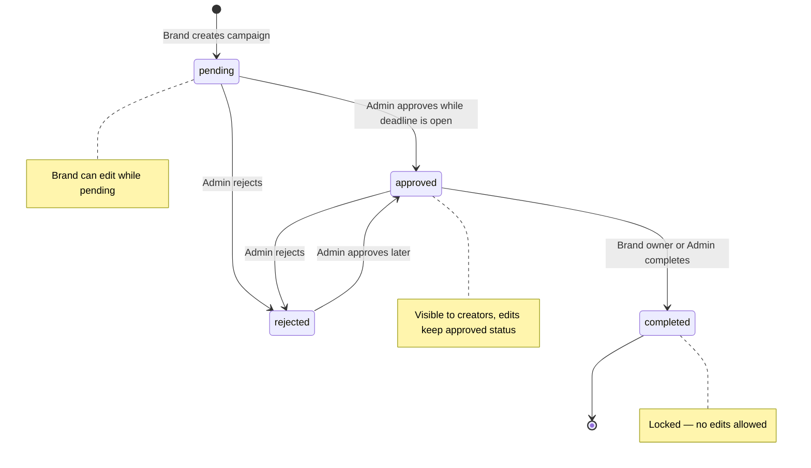

### Campaign Rules

| Rule | Enforced in |
| --- | --- |
| New campaigns are always `pending` | Controller |
| Deadline must be at least 1 hour in the future on create | Controller |
| Deadline must be a valid future date on update | Controller + schema |
| Only owners/admins can edit, complete, or delete | Controller |
| Completed/rejected campaigns cannot be edited | Controller |
| Expired campaigns cannot be approved | Controller |
| Campaigns with submissions cannot be deleted | Controller |
| Titles, descriptions, rewards bounds | Controller + schema |
| Status must be one of the four enum values | Schema |

---

## Submission Lifecycle

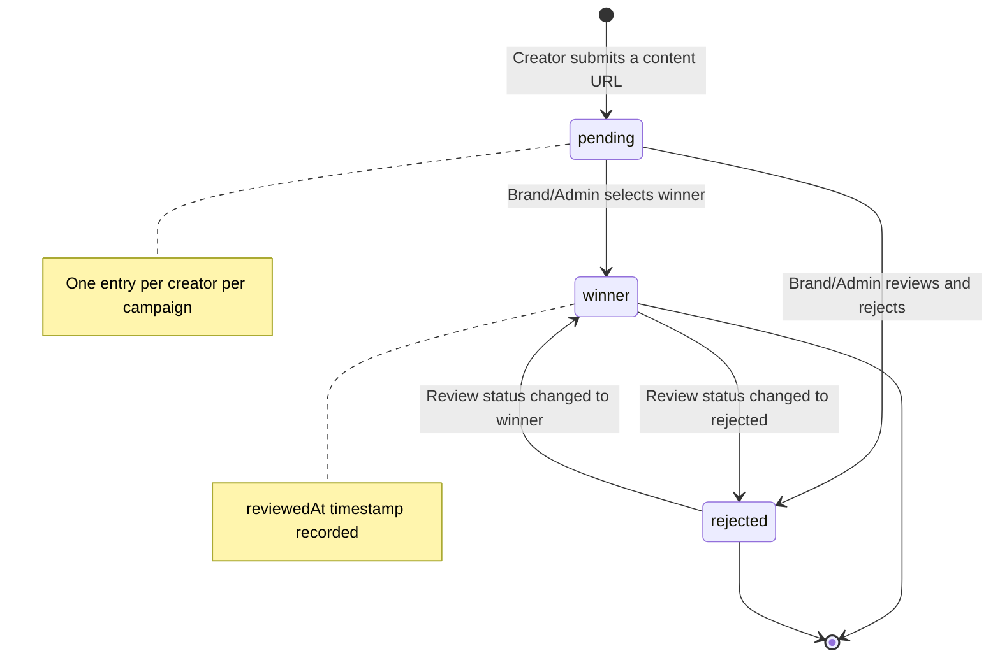

### Submission Rules

| Rule | Enforced in |
| --- | --- |
| Only creators can submit | Route role gate |
| Campaign must be approved | Controller |
| Deadline must not have passed | Controller |
| Campaign owner cannot submit to their own campaign | Controller |
| One submission per creator per campaign | Controller check + unique index |
| Content URL must be `http(s)` and ≤ 2048 chars | Controller + schema |
| Only campaign owner/admin can view, review, or select winners | Controller |
| Status must be `pending`, `winner`, or `rejected` | Controller + schema |
| Feedback is trimmed and ≤ 500 chars | Controller + schema |

---

## End-to-End Flow

The complete contest lifecycle across all three roles:

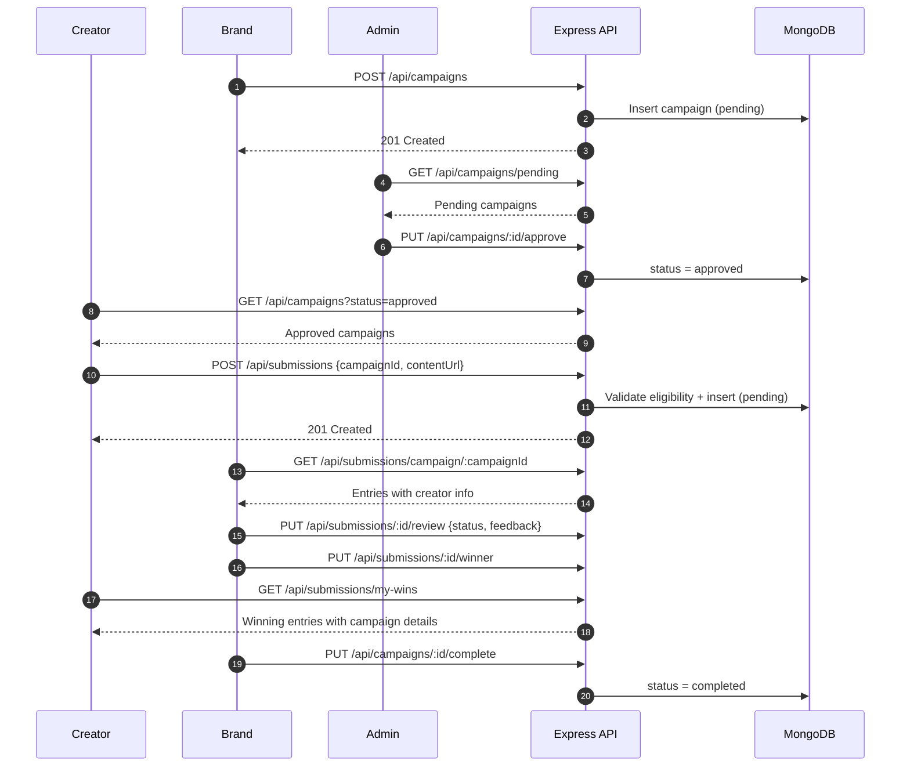

---

## Analytics & Distribution

The analytics endpoints aggregate each collection with `countDocuments` and MongoDB aggregation pipelines.

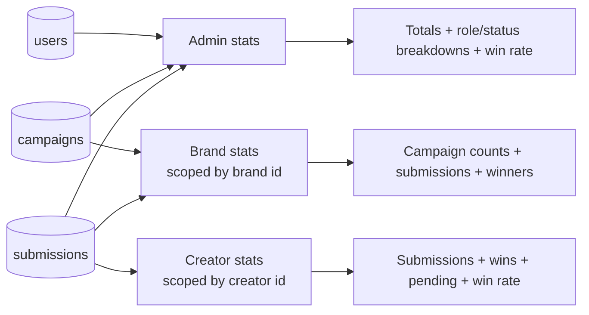

### Illustrative Distribution Diagrams

The admin endpoint reports these distributions. Values below are **illustrative examples**, not live data.

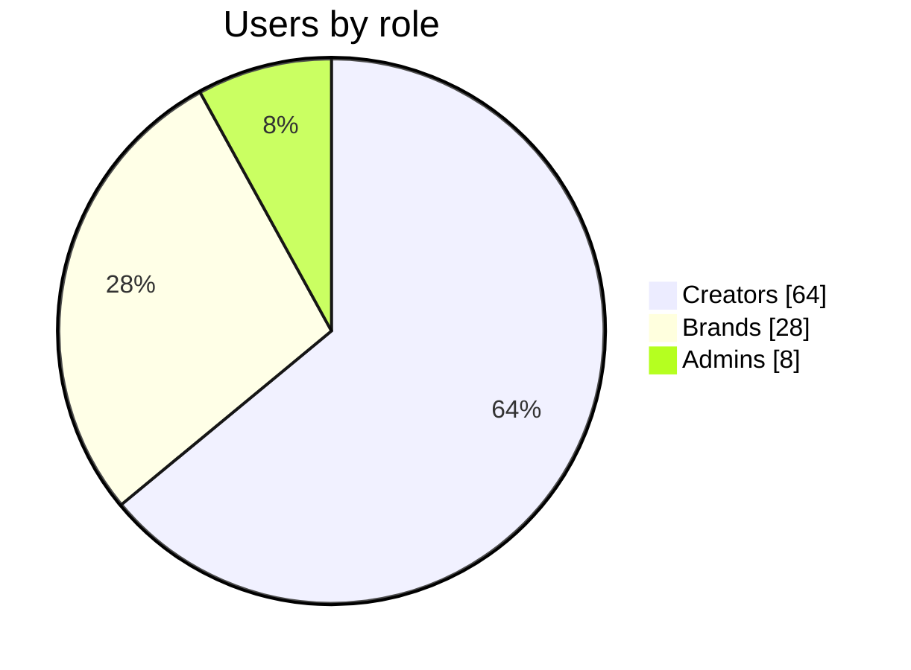

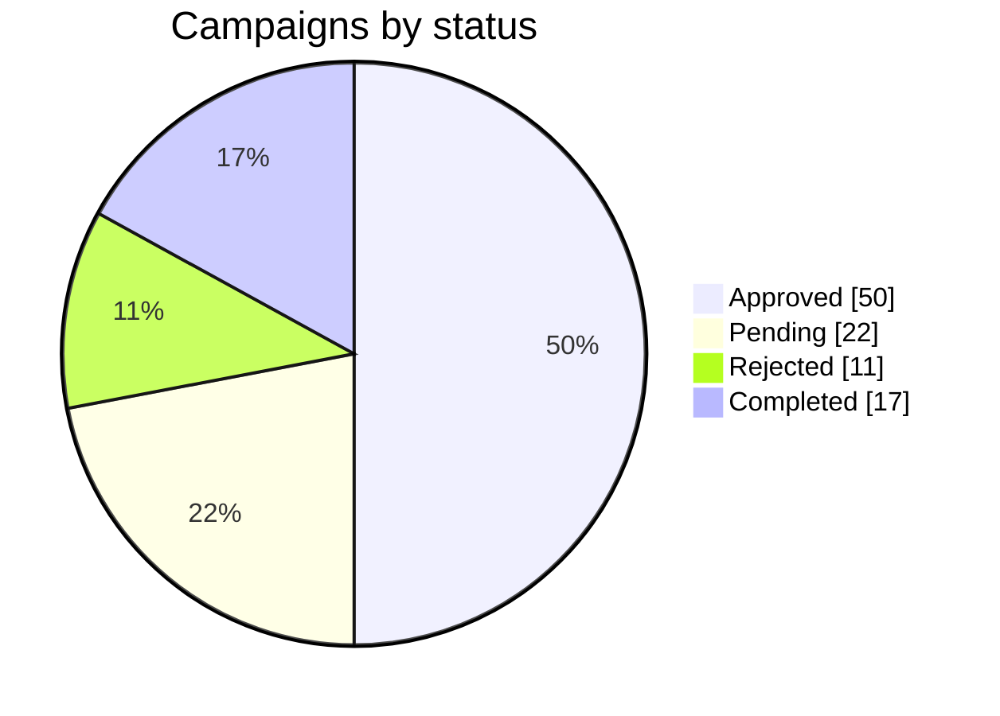

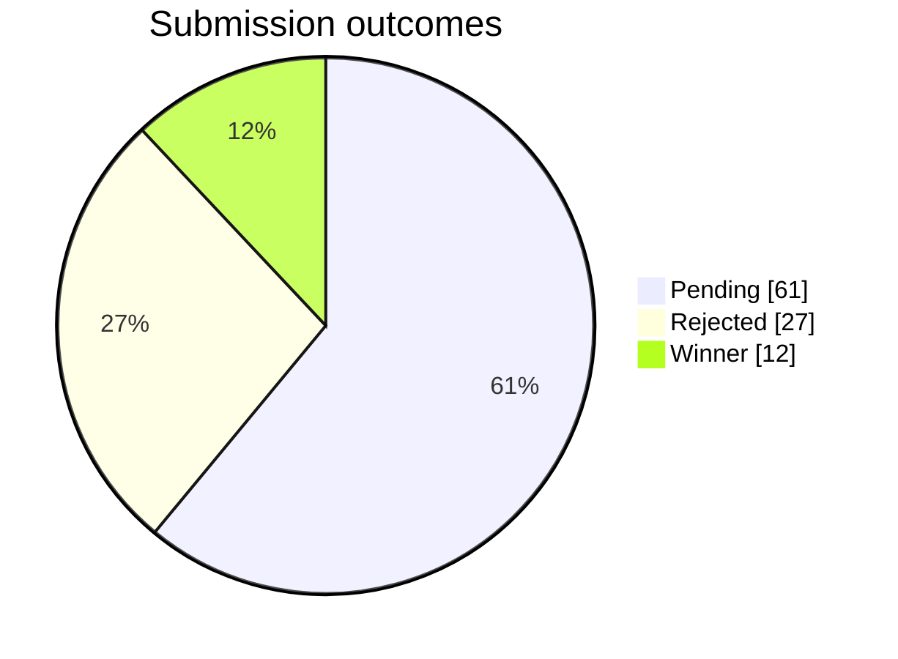

### Metric Formulas

| Metric | Formula |
| --- | --- |
| Admin win rate | `winners ÷ total submissions × 100` (2 decimals) |
| Creator win rate | `wins ÷ total submissions × 100` (1 decimal) |
| Brand average submissions | `submissions received ÷ total campaigns` (1 decimal) |
| Brand active campaigns | Count where `status = approved` **and** `deadline > now` |

---

## Validation Matrix

Validation is applied in layers — the controller returns friendly errors first, while Mongoose acts as the last line of defense.

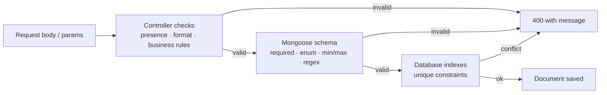

### User

| Field | Rules |
| --- | --- |
| `name` | Required; 2–50 chars after trim |
| `email` | Required; matches `/^\w+([.-]?\w+)*@\w+([.-]?\w+)*(\.\w{2,})+$/`; lowercase; ≤ 100 chars; unique |
| `password` | Required; ≥ 6 chars; on register/change must contain a letter **and** a number |
| `role` | Enum: `brand`, `creator`, `admin`; default `creator`; lowercase |

### Campaign

| Field | Rules |
| --- | --- |
| `brand` | Required ObjectId reference to a user |
| `title` | Required; 3–150 chars |
| `description` | Required; 10–3000 chars |
| `reward` | Required; 1–100 chars |
| `deadline` | Required; valid future date; create requires ≥ 1 hour ahead |
| `status` | Enum: `pending`, `approved`, `rejected`, `completed`; default `pending` |

### Submission

| Field | Rules |
| --- | --- |
| `campaign` | Required ObjectId reference |
| `creator` | Required ObjectId reference |
| `contentUrl` | Required; matches `^https?://`; no whitespace; ≤ 2048 chars |
| `status` | Enum: `pending`, `winner`, `rejected`; default `pending` |
| `feedback` | Optional; trimmed; ≤ 500 chars; default `""` |
| `reviewedAt` | `null` until first review |
| `(campaign, creator)` | Unique pair |

### Request-Level Guards

| Guard | Middleware | Applied To |
| --- | --- | --- |
| JWT cookie valid | `auth.middleware` | Every protected route |
| Role allowed | `role.middleware` | Role-specific routes |
| ObjectId format | `validateObjectId.middleware` | Routes with `:id` / `:campaignId` |
| Regex injection | `escapeRegex` | Campaign search |
| Sort field injection | Allowlist in controller | Campaign sorting |
| Pagination bounds | `getPaginationOptions` | Campaign listing (limit clamped to 50) |
| Request flood | `rateLimit` | Global + auth routes |

---

## Error Handling

Controllers catch expected failures and respond directly. Anything uncaught reaches the centralized handler in [`src/middleware/error.middleware.js`](src/middleware/error.middleware.js), which maps known error types:

| Error Type | Status | Response |
| --- | --- | --- |
| Mongoose `CastError` | `400` | `Resource not found with id of <value>` |
| Mongoose `ValidationError` | `400` | All validator messages joined by `, ` |
| Duplicate key (`11000`) | `400` | `Duplicate value entered for <field> field` |
| `JsonWebTokenError` | `401` | `Invalid token` |
| `TokenExpiredError` | `401` | `Token has expired` |
| Invalid JSON body | `400` | `Invalid JSON payload` |
| Unmatched route | `404` | `Route <url> not found` |
| Anything else | `500` | Error message or `Internal Server Error` |

### Status Codes

| Code | Meaning in this API |
| --- | --- |
| `200` | Successful read/update |
| `201` | User, campaign, or submission created |
| `400` | Validation failure, duplicate entry, ineligible action |
| `401` | Missing/invalid/expired token |
| `403` | Authenticated but lacking role or ownership |
| `404` | Resource or route not found |
| `429` | Rate limit exceeded (includes `Retry-After`) |
| `500` | Unexpected server/database failure |

---

## Security

| Control | Implementation |
| --- | --- |
| Password hashing | bcryptjs, 10 salt rounds |
| Token signing | HS256 via `jsonwebtoken`, `JWT_SECRET` from env |
| Cookie hardening | `httpOnly`, `secure`, `sameSite=none`, 24h expiry |
| Response hardening | `X-Content-Type-Options`, `X-Frame-Options: DENY`, HSTS, referrer policy, removes `X-Powered-By` |
| Brute-force protection | Auth limiter: 15 requests / 15 min / IP |
| API flood protection | Global limiter: 200 requests / 15 min / IP |
| Credential enumeration | Identical `Invalid credentials` for unknown email and wrong password |
| NoSQL/regex injection | Search input escaped; sort field allowlisted |
| Mass assignment | Controllers whitelist writable fields; `brand`, `status`, and ownership never taken from request body |
| Password leakage | `password` and `__v` stripped from `toJSON`/`toObject` |
| CORS | Explicit origin allowlist with credentials enabled |
| Duplicate submissions | DB-level unique compound index |

### Rate Limits

| Scope | Window | Max Requests | Response on Limit |
| --- | --- | --- | --- |
| `/api/auth/register`, `/api/auth/login` | 15 minutes | 15 per IP | `429` + `Retry-After` + `retryAfterSeconds` |
| All API routes | 15 minutes | 200 per IP | `429` + `Retry-After` + `retryAfterSeconds` |

> The limiter is an in-memory fixed window per process. It resets on restart and does not coordinate across multiple instances — use a shared store such as Redis when scaling horizontally.

---

## Getting Started

### Prerequisites

- Node.js 20.19+ (required by Mongoose 9; the project uses CommonJS)
- MongoDB running locally **or** a MongoDB Atlas connection string

### Installation

```bash
# 1. Clone the repository
git clone <repository-url>
cd BrandForge_full/backend

# 2. Install dependencies
npm install

# 3. Create your environment file
#    (see Environment Variables below)

# 4. Start the development server
npm run dev
```

The API starts at `http://localhost:5000`. The MongoDB connection is initiated at boot without blocking the listener; if it fails, the process logs the error and exits with code `1`.

### Verify It's Running

```bash
curl http://localhost:5000/
# BrandForge API is running
```

### Try the Auth Flow

```bash
# Register a brand
curl -X POST http://localhost:5000/api/auth/register \
  -H "Content-Type: application/json" \
  -d '{"name":"Ava Sharma","email":"ava@example.com","password":"brandpass1","role":"brand"}'

# Log in and persist the cookie
curl -i -c cookies.txt -X POST http://localhost:5000/api/auth/login \
  -H "Content-Type: application/json" \
  -d '{"email":"ava@example.com","password":"brandpass1"}'

# Use the cookie
curl -b cookies.txt http://localhost:5000/api/auth/me
```

### Available Scripts

| Command | Description |
| --- | --- |
| `npm run dev` | Start with nodemon and auto-reload on file changes |
| `node src/server.js` | Start without reload (production style) |

---

## Environment Variables

Create a `.env` file in the project root. It is git-ignored and must never be committed.

| Variable | Required | Default | Description |
| --- | --- | --- | --- |
| `PORT` | No | `5000` | HTTP port the server listens on |
| `MONGO_URI` | Yes | — | MongoDB connection string (local or Atlas) |
| `JWT_SECRET` | Yes | — | Secret used to sign and verify JWTs; use a long random value |

```dotenv
PORT=5000
MONGO_URI=mongodb+srv://<user>:<password>@<cluster>/brandforge?retryWrites=true&w=majority
JWT_SECRET=<long-random-secret>
```

> If MongoDB connection fails at startup, the process logs the error and exits with code `1`.

---

## Deployment

The API is designed for deployment on **Render**, with the database on **MongoDB Atlas**.

1. Create a MongoDB Atlas cluster and allow Render's outbound IPs (or `0.0.0.0/0` during setup).
2. Create a new Render **Web Service** pointing at this repository's `backend` directory.
3. Configure:
   - **Build command:** `npm install`
   - **Start command:** `node src/server.js`
   - **Health check path:** `/`
4. Add `MONGO_URI`, `JWT_SECRET`, and `PORT` in the Render environment settings.
5. Ensure the deployed frontend origin is present in the CORS allowlist in [`src/server.js`](src/server.js) — it currently allows `http://localhost:5173` and `https://brand-forge-frontend.vercel.app`.
6. Serve the frontend over HTTPS so the `Secure; SameSite=None` auth cookie is accepted cross-site.

---

## API Conventions

- **Content type:** `application/json` for all requests and responses.
- **Authentication:** cookie-based. Send `credentials: "include"` from fetch/axios.
- **Dates:** ISO 8601 strings in UTC.
- **IDs:** MongoDB ObjectId strings in `_id`; the JWT `id` claim identifies the caller.
- **Error shape:** consistently `{ "message": "..." }`; rate-limit responses also include `retryAfterSeconds`.
- **User shape:** login returns `user.id`; other user-bearing responses use `_id` (Mongoose documents).
- **Campaign list shape:** array by default, `{ data, pagination }` when list params are supplied.
- **Population:** campaigns embed brand `name`/`email`; submissions embed creator `name`/`email` or campaign summary fields depending on the endpoint.

---

## Known Limitations

These are current behaviors worth knowing before extending the API:

1. **Registration accepts client-supplied roles, including `admin`.** Restrict this to trusted flows before public production use.
2. **Campaign status transitions are only partially guarded.** For example, a `completed` campaign can be re-approved while its deadline is still in the future, and editing an `approved` campaign keeps it approved without re-review.
3. **`selectWinner` does not check the campaign's status or deadline.** Winners can be selected on any submission regardless of campaign state; multiple winners per campaign are allowed.
4. **JWTs are stateless.** Password changes and logout do not revoke already-issued tokens; they expire after 24 hours. There is no refresh-token rotation.
5. **Rate limiting is in-memory and per-instance.** It resets on restart and is not shared across horizontally scaled instances.
6. **Dual response shape for campaign listing** (array vs `{ data, pagination }`) exists for backwards compatibility.
7. **CORS origins are hardcoded** in `src/server.js`.
8. **No automated test suite or CI pipeline** is configured yet.
9. **No email verification or password reset flow** exists.

---

## Roadmap

Planned improvements, aligned with the `validations` branch work:

- [ ] Extract controller-level validation into a shared validation layer (e.g., schema validation per route)
- [ ] Tighten campaign/submission state transition rules
- [ ] Prevent privilege escalation through client-supplied registration roles
- [ ] Add integration tests for auth, campaign, submission, and analytics flows
- [ ] Introduce refresh tokens and session revocation
- [ ] Move rate limiting to a shared store (Redis)
- [ ] Externalize CORS origins and other config to environment variables
- [ ] Add pagination to submissions and user listings
- [ ] Add API documentation tooling (OpenAPI/Swagger)
- [ ] Add structured request logging and health/readiness endpoints

---

## Contributing

1. Branch from `main` using a descriptive name (e.g., `validations`, `feat/xyz`).
2. Follow the existing commit style: `feat(scope): summary`, `fix(scope): summary`.
3. Keep controllers responsible for business rules and schemas responsible for structural constraints.
4. Do not commit `.env` files or secrets.
5. Test affected endpoints manually before opening a pull request.

---

## License

ISC — see `package.json`.
